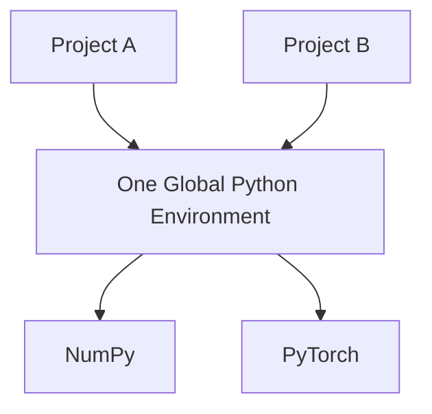
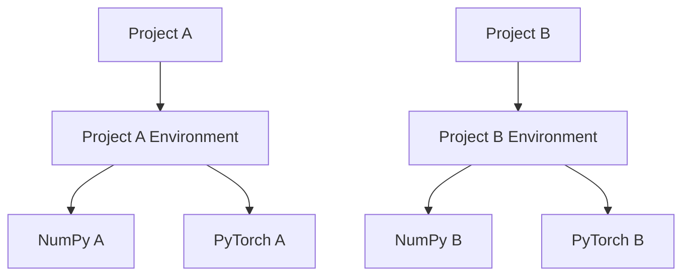
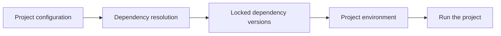
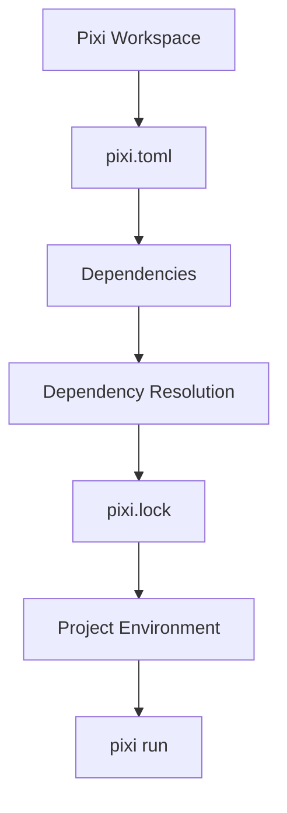
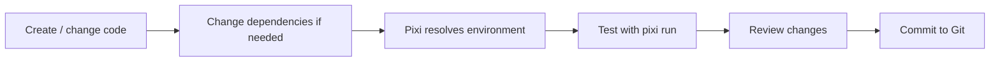
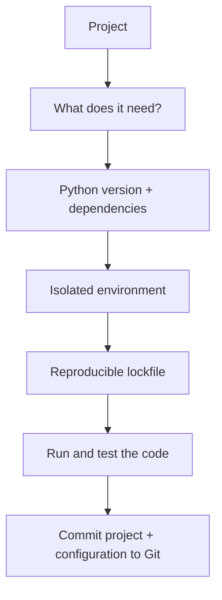

# 01 - Python Environment and Pixi

This chapter explains **why project environments are needed** and **how we manage them with Pixi**.

The goal is not to memorize commands. The goal is to understand what is happening when a Python project runs.

---

# Part 1 - Understanding Python Environments

## 1. What is a Python environment?

A Python environment is the setup in which a Python project runs.

It mainly includes:

- A Python interpreter/version
- The Python packages installed for the project
- The versions of those packages
- Environment variables and other configuration used by the project

For example:

```text
Python 3.12
    |
    +-- NumPy
    +-- Pandas
    +-- PyTorch
    +-- OpenCV
```

A project uses this environment when its code is executed.

---

## 2. Why do projects need separate environments?

Different projects can need different versions of Python and different package versions.

For example:

```text
Project A
Python 3.12
NumPy version A
PyTorch version A

Project B
Python 3.11
NumPy version B
PyTorch version B
```

If both projects use one global environment, changing a package for one project can break the other project.

### Without separate environments



Both projects depend on the same installed packages.

### With separate environments



Each project can have its own setup.

---

## 3. The main idea: isolation

The important word is **isolation**.

An isolated environment means:

> This project's Python and packages are managed separately from another project's Python and packages.

This makes projects safer to develop and easier to reproduce on another machine.

---

## 4. Environment is more than Python packages

A project environment can involve several things:

```text
Project Environment
    |
    +-- Python version
    +-- Python packages
    +-- Package versions
    +-- Environment variables
    +-- Native/system dependencies
    +-- GPU/CUDA-related dependencies (when required)
```

A Python virtual environment mainly isolates the Python side of the project. It does **not** isolate the whole operating system.

For example, these are different layers:

```text
Operating System
      |
      +-- NVIDIA Driver
      +-- CUDA
      +-- System Libraries
      |
      +-- Project Environment
             |
             +-- Python
             +-- NumPy
             +-- PyTorch
```

This distinction becomes important later for Deep Learning and ROS/ROS2.

---

## 5. Dependency

A **dependency** is something a project needs in order to run or perform its work.

Examples:

```text
Python
NumPy
Pandas
PyTorch
OpenCV
```

If our code contains:

```python
import numpy
```

then NumPy is a dependency of that code.

If the required package is not available in the current environment, Python may raise an error such as:

```text
ModuleNotFoundError: No module named 'numpy'
```

Sometimes the code is correct and the real problem is simply that the wrong environment is being used.

---

## 6. Reproducibility

A good project should allow another developer to recreate its environment.

For example:



This is called **reproducibility**.

If we know exactly what the project requires, another developer can create a matching environment instead of manually guessing which packages and versions to install.

---

## 7. Environment variables

Environment variables are values provided by the operating system or shell that programs can read.

Common examples:

```text
PATH
HOME
API_KEY
DATABASE_URL
CUDA_HOME
ROS_DOMAIN_ID
```

Python can access them with the `os` module:

```python
import os

value = os.environ.get("HOME")
print(value)
```

Environment variables are related to a project environment, but they are not the same thing as installed Python packages.

---

# Part 2 - Managing the Environment with Pixi

## 8. What is Pixi?

**Pixi is a project and package management tool that can create and manage reproducible environments.**

It can manage Python packages as well as packages from the Conda ecosystem, and it can also work with packages from PyPI.

For our learning journey, Pixi will be the tool we use to manage the Python environment of this repository.

---

## 9. Pixi's mental model

Think of Pixi like this:



In simple terms:

1. We create a **workspace** for the project.
2. We declare what the project needs.
3. Pixi resolves compatible packages.
4. Pixi records the resolved state in `pixi.lock`.
5. Pixi creates/manages the environment.
6. We run commands inside that environment.

---

## 10. Pixi Workspace

A **workspace** is the project managed by Pixi.

Our workspace is:

```text
python-robotics-learning/
```

The workspace contains the project's configuration, dependencies, lockfile and source code.

Think of it as:

```text
Pixi workspace = project + environment configuration + dependencies + tasks
```

---

## 11. `pixi.toml`

`pixi.toml` is the main Pixi project configuration file.

It describes things such as:

- Project information
- Dependencies
- Environments
- Tasks
- Other Pixi configuration

For example, a dependency section can look conceptually like:

```toml
[dependencies]
python = "3.12.*"
```

The important idea is:

> `pixi.toml` describes what the project wants.

---

## 12. `pixi.lock`

`pixi.lock` records the resolved dependency state.

A simple way to remember the difference is:

```text
pixi.toml  -> What we ask for
pixi.lock  -> What Pixi resolved and locked
```

The lockfile helps different machines create a consistent environment.

### Git rule

Commit this file:

```text
pixi.lock ✅
```

because it is part of reproducibility.

---

## 13. `.pixi`

Pixi creates local environment data under the project's `.pixi` directory.

This is machine-specific environment state.

We normally do **not** commit it to Git.

So the basic rule is:

```text
pixi.toml     ✅ Commit
pixi.lock     ✅ Commit
source code   ✅ Commit
.pixi/        ❌ Do not commit
```

---

## 14. Channels

For Conda-style packages, Pixi can use package **channels**.

A commonly used channel is:

```text
conda-forge
```

A channel is simply a source from which packages can be obtained.

Conceptually:

```text
Pixi
  |
  v
Channel
  |
  v
Package
```

We do not need to know all channel details yet. This will become more useful when we reach scientific computing and ROS/ROS2.

---

# Part 3 - Important Pixi Commands

We only need a small set of commands right now.

## 15. Create a workspace

```bash
pixi init my-project
```

Creates a new Pixi workspace.

For the current directory:

```bash
pixi init
```

---

## 16. Add a dependency

```bash
pixi add python=3.12
```

Add more dependencies later with:

```bash
pixi add numpy pandas
```

The important idea is:

> `pixi add` declares a project dependency and lets Pixi resolve it with the rest of the environment.

---

## 17. Remove a dependency

```bash
pixi remove numpy
```

Use this when a package is no longer required by the project.

---

## 18. Install the environment

```bash
pixi install
```

This makes sure the local environment matches the project's configuration and lockfile.

---

## 19. Run a command in the environment

```bash
pixi run python --version
```

Run a Python file:

```bash
pixi run python main.py
```

The important idea is:

> `pixi run` runs the command using the project's Pixi environment.

This is one of the most useful commands in our workflow.

---

## 20. Open a shell inside the environment

```bash
pixi shell
```

Now commands such as:

```bash
python
```

use the Pixi environment.

When finished, leave the shell with:

```bash
exit
```

For normal project commands, we can also use `pixi run` directly without entering a shell.

---

## 21. See installed packages

```bash
pixi list
```

This helps answer:

> What packages are currently available in the environment?

---

## 22. See dependency relationships

```bash
pixi tree
```

This shows the dependency tree.

It is useful for understanding which packages depend on other packages.

---

## 23. Update dependencies

```bash
pixi update
```

This updates dependencies according to the project's version constraints and refreshes the lock information as needed.

It is different from `pixi add`:

```text
pixi add     -> Add a dependency
pixi update  -> Update existing dependencies
```

---

## 24. Search for packages

```bash
pixi search numpy
```

This can help us check package availability in the configured package sources.

---

## 25. Get environment/workspace information

```bash
pixi info
```

This is especially useful when debugging an environment problem.

---

# Part 4 - Our Normal Workflow

For this repository, the basic workflow will be:



Typical commands will look like:

```bash
pixi add <package>
pixi run python <file.py>
pixi list
pixi tree
git status
git add .
git commit -m "..."
```

---

# Part 5 - What We Commit to Git

Our repository should contain the things needed to understand and recreate the project.

```text
python-robotics-learning/
│
├── pixi.toml        # Project configuration
├── pixi.lock        # Locked dependency state
├── .gitignore       # Files/directories Git should ignore
├── README.md        # Project documentation
│
├── 01-python-environment/
├── 02-python-fundamentals/
└── ...
```

We commit:

```text
Source code          ✅
Documentation        ✅
`pixi.toml`          ✅
`pixi.lock`          ✅
```

We do not commit:

```text
`.pixi/`              ❌
Python cache files    ❌
Other local artifacts ❌
```

---

# Part 6 - Important Things to Remember

## Environment

An environment is the setup used by a project to run its code.

## Isolation

Separate environments allow different projects to use different Python and package versions without interfering with each other.

## Dependency

A dependency is something the project needs, such as NumPy or PyTorch.

## Reproducibility

A reproducible project lets another machine recreate the same dependency setup reliably.

## Pixi workspace

The project managed by Pixi.

## `pixi.toml`

Describes the project's desired configuration and dependencies.

## `pixi.lock`

Records the resolved dependency state so the environment can be reproduced consistently.

## `.pixi`

Local Pixi environment data. Keep it out of Git.

## `pixi add`

Add a dependency.

## `pixi remove`

Remove a dependency.

## `pixi install`

Create/update the local environment from the project configuration and lockfile.

## `pixi run`

Run a command inside the project's environment.

## `pixi shell`

Enter an interactive shell using the project's environment.

## `pixi list`

See installed packages.

## `pixi tree`

See dependency relationships.

## `pixi update`

Update existing dependencies.

## `pixi info`

Inspect workspace/environment information.

---

# Final Mental Model

When working on a Python project, always think in this order:



For our project, Pixi handles most of the environment-management work:

```text
Project
   |
   v
pixi.toml
   |
   v
Dependencies
   |
   v
Pixi
   |
   +----> Environment
   |
   +----> pixi.lock
   |
   +----> pixi run
```

We will learn more Pixi features only when they become useful. There is no need to memorize the entire Pixi CLI before learning Python.

---

# Chapter 1 Complete

The environment and project-management foundation is now in place.

The next chapter starts the actual Python language:

> **Chapter 2 - Python Fundamentals: syntax, variables, values, types, operators, input/output and control flow.**
