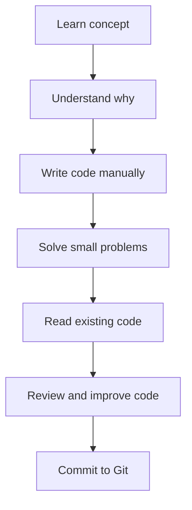
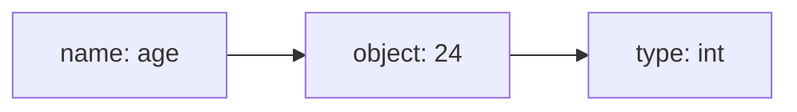
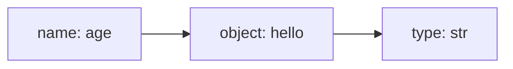
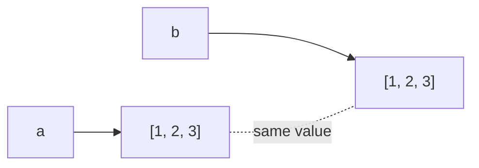
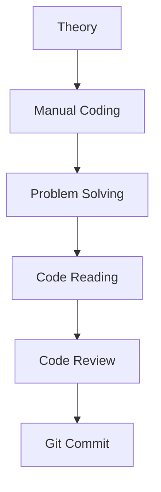

# Chapter 2 — Python Fundamentals

This chapter covers the basic Python concepts needed to start writing and reading Python comfortably.

The goal is not just to remember syntax. The goal is to understand how Python works well enough to:

- write small programs manually
- read existing Python code
- review code for correctness and readability
- recognize important differences from Java
- build a strong foundation for OOP, NumPy, Pandas, PyTorch, ROS and ROS2

---

## 1. How We Are Learning Python

Our learning cycle is:



Knowing Python syntax is only the beginning.

A strong Python developer should be able to:

| Skill | Question |
|---|---|
| Write | Can I create the code myself? |
| Read | Can I understand code written by someone else? |
| Review | Can I identify bugs, edge cases and poor design? |

We will practice all three throughout this course.

---

# 2. First Python Program

A simple Python program can be:

```python
print("Hello, Python!")
```

Run it through our Pixi environment:

```bash
pixi run python hello.py
```

Compared with Java, Python has much less ceremony for a small program.

### Java

```java
public class Hello {
    public static void main(String[] args) {
        System.out.println("Hello, Java!");
    }
}
```

### Python

```python
print("Hello, Python!")
```

Python is designed to make common code concise.

---

# 3. Indentation Is Part of Python Syntax

Python uses indentation to define blocks of code.

```python
if age >= 18:
    print("Adult")
    print("Can vote")
```

The indented statements belong to the `if` block.

The general structure is:

```text
if condition:
    statement
    statement
    statement
```

The `:` starts the block, and indentation defines which statements belong to it.

### Java comparison

Java uses braces:

```java
if (age >= 18) {
    System.out.println("Adult");
    System.out.println("Can vote");
}
```

Python does not use braces for normal code blocks:

```python
if age >= 18:
    print("Adult")
    print("Can vote")
```

### Important

Indentation in Python is not merely formatting.

This is invalid:

```python
if age >= 18:
print("Adult")
```

The code must be indented correctly.

---

# 4. Comments

A single-line comment starts with `#`.

```python
# This is a comment
print("Hello")
```

Comments are ignored by the Python interpreter.

Use comments to explain something that is useful for a reader to know.

Do not use comments to explain obvious code unnecessarily.

For example:

```python
# Add 1 to count
count += 1
```

is usually unnecessary because the code already explains itself.

---

# 5. Statements and Expressions

Understanding the difference helps when reading Python code.

## Expression

An expression produces a value.

Examples:

```python
10 + 20
age >= 18
name + "!"
```

For example:

```python
10 + 20
```

produces:

```text
30
```

And:

```python
age >= 18
```

produces either:

```text
True
```

or:

```text
False
```

## Statement

A statement performs an action or controls execution.

Examples:

```python
age = 24

if age >= 18:
    print("Adult")
```

You do not need to memorize a strict formal definition at this stage. The important point is to recognize that Python contains both expressions that produce values and statements that perform actions or structure program flow.

---

# 6. Variables and Names

Python does not normally require a variable declaration such as Java:

```java
int age = 24;
String name = "Sam";
```

Python:

```python
age = 24
name = "Sam"
```

Python is dynamically typed.

That means the type of a name can change when the name is rebound:

```python
age = 24
age = "twenty four"
```

After the second assignment, `age` refers to a string object.

---

# 7. The Important Python Mental Model: Names Refer to Objects

A better way to think about Python is:

> Python objects have types, and names refer to objects.

For:

```python
age = 24
```

think of it roughly as:



Later:

```python
age = "hello"
```

the name is rebound:



This idea becomes very important when we learn:

- lists
- dictionaries
- mutability
- functions
- classes
- objects
- references

It is better to learn this mental model early rather than thinking of Python variables exactly like Java primitive variables.

---

# 8. Built-in Basic Types

The first types you should know are:

```text
int
float
bool
str
NoneType
```

Examples:

```python
age = 24
price = 99.5
is_active = True
name = "Sam"
result = None
```

---

# 9. `int`

Integers are whole numbers.

```python
age = 24
temperature = -5
count = 100
```

Python integers can grow to very large values without the fixed-size limitation of Java's usual `int`.

For example:

```python
x = 10 ** 100
print(x)
```

Python can represent this directly.

In Java, you would need to consider larger or arbitrary-precision numeric types for sufficiently large integers.

---

# 10. `float`

Floating-point numbers contain a fractional part.

```python
price = 99.99
temperature = 36.5
```

Floating-point numbers have the same general representation and precision limitations seen in many programming languages.

For example:

```python
print(0.1 + 0.2)
```

Do not assume that the result must be represented as exactly `0.3`.

This is a property of floating-point representation, not a Python-specific bug.

---

# 11. `bool`

Boolean values are:

```python
True
False
```

Example:

```python
is_logged_in = True
is_admin = False
```

### Java comparison

Java:

```java
true
false
```

Python:

```python
True
False
```

Python uses capitalized Boolean literals.

---

# 12. `None`

`None` represents the absence of a value.

```python
result = None
```

It is often compared with Java's `null` for intuition, although they are not identical concepts in every detail.

A common Python pattern is:

```python
if value is None:
    print("No value")
```

Prefer:

```python
is None
```

rather than:

```python
== None
```

when specifically checking for `None`.

---

# 13. Checking a Type

Use the built-in `type()` function:

```python
age = 24
print(type(age))
```

Output:

```text
<class 'int'>
```

Examples:

```python
print(type(24))
print(type(24.5))
print(type(True))
print(type("hello"))
print(type(None))
```

Understanding types is important because Python is dynamically typed but still strongly relies on object types at runtime.

---

# 14. Strings

Strings can be written with either single or double quotes:

```python
name = "Sam"
city = 'Lucknow'
```

Both are valid.

## Concatenation

```python
first_name = "Sam"
last_name = "Parihar"

full_name = first_name + " " + last_name
```

## f-strings

For formatted text, f-strings are one of the most useful everyday Python features:

```python
name = "Sam"
age = 24

print(f"My name is {name} and I am {age} years old.")
```

The values inside `{}` are evaluated and inserted into the string.

Use f-strings frequently when constructing readable output.

---

# 15. Type Conversion

Python allows explicit conversion between compatible types.

Examples:

```python
int("24")
float("10.5")
str(100)
bool(1)
```

Example:

```python
age = "24"
age = int(age)
```

Now `age` refers to an integer.

Invalid conversions can raise exceptions:

```python
int("hello")
```

This produces an error because `"hello"` cannot be converted to an integer.

Exception handling will be covered later in the course.

---

# 16. User Input

Use `input()` to read text from the user:

```python
name = input("Enter your name: ")
print(name)
```

### Important rule

`input()` always returns a string.

So:

```python
age = input("Enter age: ")
```

makes `age` a `str`, even if the user enters:

```text
24
```

To convert it:

```python
age = int(input("Enter age: "))
```

This distinction is important when working with numbers.

---

# 17. Arithmetic Operators

Python provides the usual arithmetic operators.

```python
a = 10
b = 3

print(a + b)
print(a - b)
print(a * b)
print(a / b)
print(a // b)
print(a % b)
print(a ** b)
```

The important operators are:

| Operator | Meaning |
|---|---|
| `+` | Addition |
| `-` | Subtraction |
| `*` | Multiplication |
| `/` | Division |
| `//` | Floor division |
| `%` | Remainder / modulo |
| `**` | Exponentiation |

Examples:

```python
10 / 3
```

produces a floating-point result.

```python
10 // 3
```

produces:

```text
3
```

And:

```python
10 % 3
```

produces:

```text
1
```

---

# 18. Comparison Operators

Comparison operators produce Boolean values.

```python
a == b
a != b
a > b
a < b
a >= b
a <= b
```

Example:

```python
age = 20

print(age >= 18)
```

Result:

```text
True
```

---

# 19. `=` vs `==`

One of the most common beginner mistakes is confusing assignment and comparison.

## Assignment

```python
age = 20
```

Meaning:

> Bind the name `age` to the value/object `20`.

## Comparison

```python
age == 20
```

Meaning:

> Check whether `age` is equal to `20`.

Remember:

```text
=   assignment
==  equality comparison
```

---

# 20. Logical Operators

Python uses words instead of Java-style symbols.

```python
and
or
not
```

Example:

```python
age = 25
has_id = True

if age >= 18 and has_id:
    print("Allowed")
```

### Java comparison

Java:

```java
if (age >= 18 && hasId) {
    ...
}
```

Python:

```python
if age >= 18 and has_id:
    ...
```

Equivalent concepts:

| Java | Python |
|---|---|
| `&&` | `and` |
| `||` | `or` |
| `!` | `not` |

---

# 21. Conditional Statements

Python uses:

```python
if
elif
else
```

Example:

```python
marks = 75

if marks >= 90:
    print("A")
elif marks >= 75:
    print("B")
elif marks >= 50:
    print("C")
else:
    print("D")
```

Java's:

```text
else if
```

becomes:

```python
elif
```

in Python.

---

# 22. Truthiness

Python can evaluate many objects directly in a Boolean context.

For example:

```python
name = ""

if name:
    print("Name exists")
```

An empty string is considered false.

Similarly:

```python
if 0:
    print("yes")
```

does not execute.

But:

```python
if 10:
    print("yes")
```

does execute.

Later, this becomes especially important for collections:

```python
[]
{}
()
set()
```

Empty containers are considered false.

Non-empty containers are generally considered true.

This is called **truthiness**.

---

# 23. `for` Loops

Python's `for` loop iterates over values.

Example:

```python
for i in range(5):
    print(i)
```

Output:

```text
0
1
2
3
4
```

### Java comparison

Java:

```java
for (int i = 0; i < 5; i++) {
    System.out.println(i);
}
```

Python:

```python
for i in range(5):
    print(i)
```

Python's `for` is often closer in spirit to Java's enhanced `for` loop because it naturally iterates over elements.

Example:

```python
names = ["Sam", "Rahul", "Aman"]

for name in names:
    print(name)
```

Java equivalent:

```java
for (String name : names) {
    System.out.println(name);
}
```

---

# 24. `range()`

`range()` commonly generates a sequence of integer values for iteration.

### `range(stop)`

```python
range(5)
```

represents:

```text
0 1 2 3 4
```

### `range(start, stop)`

```python
range(2, 6)
```

represents:

```text
2 3 4 5
```

### `range(start, stop, step)`

```python
range(2, 10, 2)
```

represents:

```text
2 4 6 8
```

General form:

```text
range(start, stop, step)
```

The `stop` value is exclusive.

---

# 25. `while` Loops

A `while` loop continues while its condition is true.

```python
count = 0

while count < 5:
    print(count)
    count += 1
```

The overall concept is similar to Java.

Be careful to update the condition-related state, otherwise an unintended infinite loop can occur.

---

# 26. `break`

`break` immediately exits the current loop.

```python
for i in range(10):
    if i == 5:
        break

    print(i)
```

Output:

```text
0
1
2
3
4
```

---

# 27. `continue`

`continue` skips the current iteration and moves to the next one.

```python
for i in range(5):
    if i == 2:
        continue

    print(i)
```

Output:

```text
0
1
3
4
```

---

# 28. `pass`

`pass` means "do nothing".

Example:

```python
if age >= 18:
    pass
```

It can be useful when Python requires a statement but the implementation is not written yet.

You may see it in placeholder code or partially implemented codebases.

---

# 29. `==` vs `is`

This is an important Python concept.

## `==`

Checks whether two objects are equal in value.

```python
a = [1, 2, 3]
b = [1, 2, 3]

print(a == b)
```

Result:

```text
True
```

## `is`

Checks whether two names refer to the exact same object.

```python
print(a is b)
```

Result:

```text
False
```

Although the lists contain the same values, they are separate list objects.

Conceptually:



The objects have equal contents, but they are not the same object.

### Common use of `is`

Use identity checks for singletons such as `None`:

```python
if value is None:
    ...
```

Do not use `is` as a general replacement for `==`.

---

# 30. Dynamic Typing vs Type Hints

Python is dynamically typed:

```python
age = 24
age = "twenty four"
```

You can also write a type hint:

```python
age: int = 24
```

A type hint communicates intended usage to humans and tools.

It does not turn Python into Java-style static typing.

Example:

```python
age: int = 24
```

does not mean the Python runtime will enforce the variable forever as an `int`.

Type hints become much more useful when we learn functions, classes and larger codebases.

---

# 31. Naming Conventions

Python commonly uses `snake_case` for variables and functions:

```python
first_name = "Sam"
total_marks = 100
student_count = 20
```

This differs from the Java convention of commonly using camelCase:

```java
firstName
totalMarks
studentCount
```

Python class names generally use `PascalCase`:

```python
StudentRecord
RobotController
```

We will study complete Python naming and style conventions later.

---

# 32. Python vs Java — Quick Reference

| Concept | Python | Java |
|---|---|---|
| Variable | `age = 24` | `int age = 24;` |
| Boolean | `True` / `False` | `true` / `false` |
| Null-like value | `None` | `null` |
| Equality | `==` | `==` |
| Identity | `is` | No direct equivalent in normal syntax |
| Logical AND | `and` | `&&` |
| Logical OR | `or` | `||` |
| Logical NOT | `not` | `!` |
| Conditional | `if / elif / else` | `if / else if / else` |
| Loop | `for item in items` | `for (Type item : items)` |
| Block | Indentation | `{}` |
| String formatting | f-strings | String formatting/interpolation approaches |
| Type declaration | Usually omitted | Required in normal variable declarations |
| Integer size | Arbitrary precision | Fixed-width primitive integers such as `int`, plus other numeric types |
| Naming style | `snake_case` commonly | `camelCase` commonly |

Do not try to translate Java syntax into Python word-for-word.

Instead, translate the **idea**.

---

# 33. The Most Important Mental Models So Far

At the end of this chapter, remember these ideas more strongly than individual syntax rules.

## 1. Python executes through an interpreter

```text
Python source code
        ↓
Python interpreter
        ↓
Program execution
```

## 2. Names refer to objects

```text
name → object → type
```

## 3. Objects have types

```python
x = 10
```

means the object referred to by `x` is an integer object.

## 4. Python is dynamically typed

The same name can later refer to another object of another type.

## 5. Indentation defines code blocks

Indentation is part of Python syntax.

## 6. Truthiness matters

Objects can be evaluated directly in conditions.

## 7. `==` and `is` are different

- `==` → equality
- `is` → identity

## 8. Python syntax is intentionally concise

Do not force Java's structure onto Python.

---

# 34. Common Beginner Mistakes

### Mistake 1 — Treating Python exactly like Java

Writing Python while mentally expecting Java's type declarations, braces and loop syntax leads to awkward code.

Learn Python's own idioms.

### Mistake 2 — Forgetting that `input()` returns `str`

```python
age = input("Age: ")
```

means `age` is a string.

Use:

```python
age = int(input("Age: "))
```

when an integer is required.

### Mistake 3 — Confusing `=` and `==`

```python
x = 10      # assignment
x == 10     # comparison
```

### Mistake 4 — Using `is` instead of `==`

Do not write:

```python
if name is "Sam":
```

for ordinary value comparison.

Use:

```python
if name == "Sam":
```

### Mistake 5 — Ignoring indentation

Indentation is syntax, not decoration.

### Mistake 6 — Assuming dynamically typed means "untyped"

Python objects still have types.

Dynamic typing means type checking and binding happen differently from statically typed languages such as Java.

---

# 35. Code Reading Checklist

When reading unfamiliar Python code, ask:

```text
1. What names are being created?
2. What objects do those names refer to?
3. What are the object types?
4. What conditions control execution?
5. What loops are being used?
6. What values are produced?
7. Where can the type of a value change?
8. Is == or is being used, and is it appropriate?
9. How is indentation defining the blocks?
10. Are there obvious edge cases or errors?
```

This checklist will become more detailed as we learn functions, collections, exceptions and OOP.

---

# 36. Code Review Mindset

When reviewing Python code, do not stop at:

> "It works."

Review it at several levels:

```text
Correctness
    ↓
Edge cases
    ↓
Readability
    ↓
Python conventions
    ↓
Maintainability
    ↓
Performance (when relevant)
```

For example:

```python
age=int(input("Enter age: "))
if age>=18: print("Adult")
else: print("Minor")
```

This may work, but a review should also consider:

- readability
- spacing
- indentation
- naming
- input validation
- whether the formatting follows normal Python style

We will become much stricter about code review as our knowledge grows.

---

# 37. Practical Rule for This Course

For every major Python concept, we will use three stages:



This is intentional.

The end goal is not to finish a Python tutorial.

The end goal is to become comfortable working inside a real Python codebase.

---

# 38. What Comes Next

The next major topic is:

## Chapter 3 — Python Data Types and Strings

We will go deeper into:

- numbers
- strings
- indexing
- slicing
- string methods
- mutability vs immutability
- useful built-in functions
- membership and identity
- formatting
- common string-processing patterns

After that we will move into the most important Python data structures:

```text
list
tuple
set
dict
```

and begin doing more meaningful problem solving with them.

---

## Chapter 2 Completion

Before moving forward, you should be comfortable with:

```text
✓ Python syntax
✓ Indentation
✓ Variables and names
✓ Python objects
✓ Basic types
✓ Strings
✓ Type conversion
✓ input()
✓ Arithmetic operators
✓ Comparison operators
✓ Logical operators
✓ if / elif / else
✓ Truthiness
✓ for loops
✓ while loops
✓ range()
✓ break
✓ continue
✓ pass
✓ == vs is
✓ Dynamic typing
✓ Basic naming conventions
✓ Basic Python-vs-Java differences
✓ Reading simple Python code
✓ Reviewing simple Python code
```

The exercises for this chapter are intentionally kept in the chapter's code files; this README is the **long-term theory/reference document**.
